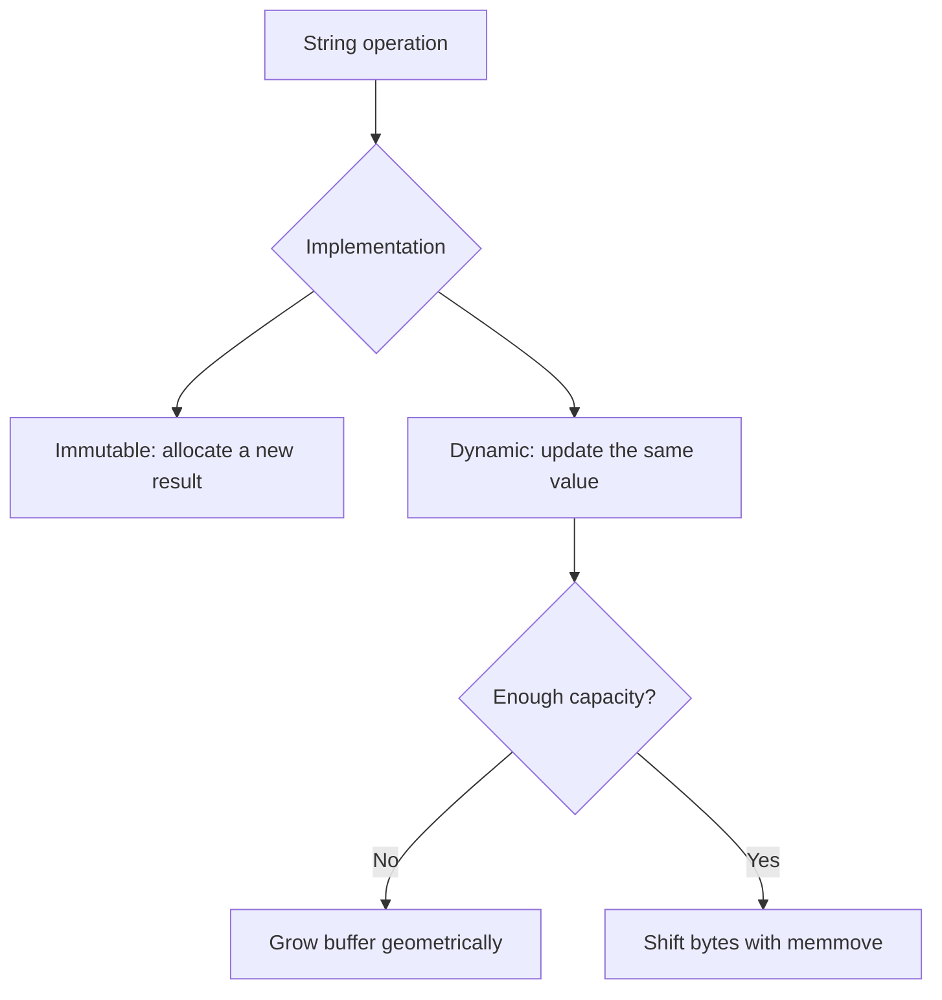

# C String Library — Immutable and Dynamic Implementations

[](https://github.com/Vinoria/c-string-library/actions/workflows/ci.yml)

A C11 string library implemented twice to compare two memory-management models:

- an **immutable implementation**, where each transformation returns a new string;
- a **dynamic in-place implementation**, where a resizable buffer is reused and grown geometrically.

This project was developed for the **PROG5** module. Both assessed variants received **100/100**. The repository edition adds independent tests, strict compiler settings, sanitizer checks, continuous integration, and technical documentation.

## What the project demonstrates

- manual heap allocation and ownership in C;
- safe overlapping copies with `memmove`;
- geometric buffer growth and controlled shrinking;
- defensive handling of null values and allocation failures;
- negative and out-of-range position normalization;
- automated testing with GCC, Clang, AddressSanitizer, and UBSan.



## API

Both variants expose the same course API:

| Function | Purpose |
|---|---|
| `ch_cree` | Create a managed string from a C string |
| `ch_libere` | Release all owned memory |
| `ch_taille` | Return the logical length |
| `ch_vers_C` | Access the null-terminated C representation |
| `ch_renverse` | Reverse the character order |
| `ch_sous_chaine` | Keep a substring |
| `ch_insere` | Insert another string |
| `ch_supprime` | Remove a range |
| `ch_remplace` | Replace a range with another string |

Negative positions are interpreted from the end of the string. Positions outside the valid range are clamped, and a negative length means “up to the end”.

## Design comparison

| Property | Immutable version | Dynamic version |
|---|---|---|
| Transformation result | New allocation | Same `chaine_t` instance |
| Original value | Preserved | Modified |
| Allocation pattern | Predictable, one result per operation | Reuses spare capacity |
| Growth strategy | Exact result size | Capacity doubles when needed |
| Shrink strategy | Exact result size | Shrinks when capacity exceeds twice the need |
| Main trade-off | Simpler value semantics | Fewer allocations over repeated edits |

## Build and test

Requirements: a C11 compiler, `make`, and `ar`.

```bash
make test
```

The command builds two static libraries and runs the independent test suite for both implementations.

To enable AddressSanitizer and UndefinedBehaviorSanitizer:

```bash
make sanitize
```

You can select a compiler explicitly:

```bash
make clean test CC=clang
```

## Repository structure

```text
.
├── include/
│   ├── dynamic/chaines.h
│   └── immutable/chaines.h
├── src/
│   ├── dynamic/chaines.c
│   └── immutable/chaines.c
├── tests/
│   ├── test_dynamic.c
│   └── test_immutable.c
├── docs/rapport-technique.md
├── .github/workflows/ci.yml
└── Makefile
```

## Documentation

The detailed French report covers the design decisions, algorithms, complexity, memory strategy, validation, and limitations:

- [Rapport technique](docs/rapport-technique.md)

## Scope and academic integrity

The course-provided test harness and memory-tracking utilities are intentionally excluded. The tests in this repository were written independently for the portfolio edition. The public repository contains the project implementations and original supporting work only.
